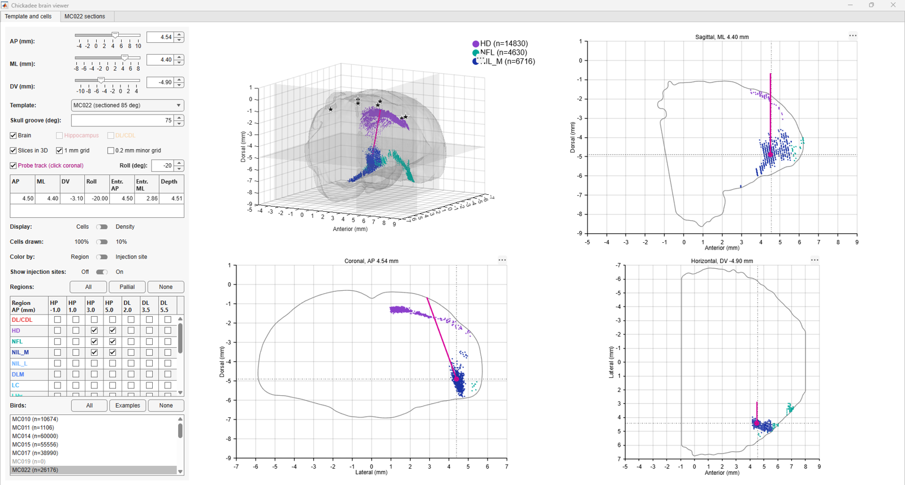

# Chickadee brain templates and labelled cells

MATLAB code for viewing retrogradely labelled cells (Applegate, Gutnichenko &
Aronov 2023, *Topography of inputs into the hippocampal formation of a
food-caching bird*, https://doi.org/10.1002/cne.25533) on chickadee brain
templates, and for building a template from an anatomy bird's coronal sections.

Coordinates are in mm relative to lambda (the point where the two hemispheres
and the cerebellum meet in the MC029 template): anterior (`xx`, anterior/posterior, anterior positive),
lateral (`yy`, medial/lateral, animal's right positive), dorsal (`zz`, dorsal/ventral, dorsal positive).
Injections are on the right.

## Layout

```
chickadee-brain-viewer/
├── brainViewer.m   main viewer
├── src/            source code
├── docs/           README screenshots
├── data/           data; downloaded from Dropbox if missing (not in git)
└── results/        figures (not in git)
```

## Quick start

 `brainViewer`  Interactive viewer (below). Needs the data (see Data; downloads automatically); builds a cache in `tempdir` on first run or when a data file changes. 

## Viewer (`brainViewer`)

**Tab 1, Template and cells.** Coronal, sagittal and horizontal slices plus a
3D view of a template with the selected cells.
- Template: MC022 (brain outline only) or MC029 (sagittally sectioned
  template, hippocampus and DL/CDL annotated).
- AP snaps to MC022's coronal sections (0.1062 mm, the fitted vibratome
  thickness); ML and DV step by 0.1 mm. Each slice view shows the cells within
  one step of its plane.
- The square button on each slice's axes toolbar draws a
  box labelled with its ΔX and ΔY in mm.
- "Probe track": click a target in the coronal slice.



**Tab 2, MC022 sections.** Each MC022 coronal section in the template frame,
with its outline and MC022's labelled cells.


**Cells.** Other birds' cells come from the Dryad data (`loadDryadCells`).

## Details

### Cells

The Dryad data is currently misaligned. MC022's own cells come from its section
images instead, for the regions its label files cover (DL/CDL, HD, NIL_M, NFL,
NIL_L). Subcortical data currently missing for MC022.

### How the MC022 template is built

`makeAnatomyTemplates` (steps are its local functions):
1. `loadAnatomyBird`: reads `metaDataUpdated3.mat` (midlines, section order,
   left/right flags), hand corrections (`midlineCorrections.mat`), the TIFF
   pixel size, outlines and joins (`data\MC022_outlines.mat`) and the labelled
   cells. Section AP = 6.9 − 0.1 × trueOrder (Dryad's convention).
2. `buildBirdTemplate`: each section's outline in mm (ML from its midline, A/B
   hemisphere pairs and hemispheres mounted apart fused by
   `fuseHemispheres`), placed at AP = scaled Dryad AP + `ap_shift`, and moved in
   DV so its dorsal surface matches MC029's (rotated by the fitted tilt and
   stretched in ML). Masks are closed, opened, and median-filtered over 3
   neighbouring sections.
3. `fitDryadTransform`: rotation + DV offset taking Dryad DV onto MC022's
   image-mapped cells (used for the other birds).

Fitted placement (`fitReferencePlacement`): vibratome scale 1.062 (applied to
MC022's AP spacing and MC029's ML, since MC029 was cut sagittally), AP shift
0.5 mm, tilt 20°, DV offset 0. AP shift and tilt trade off
along a flat ridge, so AP is the least certain of these.

### Data (not in git)

`dataDir` finds the data folder, in this order:

1. `data\` in the repository (a local copy; `makeAnatomyTemplates` and
   `makeSectionOutlines` write here).
2. The shared copy at `Z:\Hannah\imaging\plotChickadeeBrain\data` (Payne lab server).
3. Otherwise it asks, then downloads the
   [Dropbox folder](https://www.dropbox.com/scl/fo/1kjz4tkh3fw4lckc4yrw2/AIGJRO2nt89LfSsVwOjWvlE?rlkey=ec833tj9nj63ctl9vs4zgunwh&dl=0)
   (about 650 MB) into `data\`.

After rebuilding anything in the local `data\`, copy it to the Z: folder and the
Dropbox folder so the copies stay the same.

| File | Contents |
|---|---|
| `MC029_fixed.mat` | Reference template (Ibrain, Ihippo, Idl on xx/yy/zz), Hannah's corrected tracing of bird MC029. |
| `MC029_orig.mat` | Marissa's original MC029 tracing; Dryad DV was set against it. |
| `dryad_applegate2023\` | The Dryad download of Applegate et al. 2023, unchanged: `anatomy.mat` (one table of labelled cells per bird, 847,046 cells in all: ROI, Long, Transverse, Hemisphere, AP, ML, DV, wavelength) and its `README.md`. DV is against MC029_orig; `loadDryadCells` moves it onto MC029_fixed. |
| `MC022.mat` | MC022 template: Ibrain, xx/yy/zz, sections table (per-section placement, outlines, cells), P (build options), tf (Dryad transform), injections. |
| `MC022_outlines.mat` | Detected outlines and joins per section image. |
| `MC022_ds8\` | 1/8-scale section images, all four channels (89 images each; rebuilt from the raw TIFFs on `Z:` when missing). |

Raw sections: `Z:\Hannah\imaging\MC022 sortedSlices` (full-resolution TIFFs,
about 1 GB each, in four channels: file suffix 395 DAPI, 475 (488 tracer), 555,
640 (647 tracer); metaData; labelledCells per tracer channel).

### Implementation notes

- The viewer draws everything 0.5 mm posterior of the stored coordinates, along
  MC029's AP axis (`lambda_ap`), to correct lambda.
- With anterior, right and dorsal all positive the frame is left-handed, so the
  3D view reverses its ML axis to draw the right side on the right.

### Open issues

- MC022's label files cover only DL/CDL, HD, NIL_M, NFL and NIL_L; Dryad's
  6,530 MC022 cells in other regions have no image labels. The label number →
  region key is inferred from cell counts (`label_key` in
  `makeAnatomyTemplates`).
- AP placement: slice_72 lands at AP 0.02 mm but looks ~0.5 mm posterior to
  lambda by eye.
- Slice_01 needs a hand-drawn midline (`draw_corrections = true`).
- Other birds need their own alignment.
